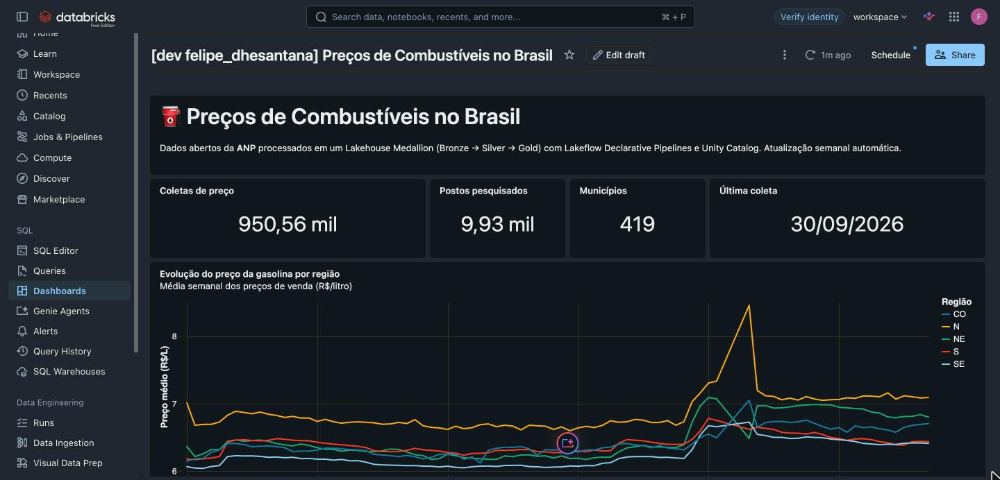
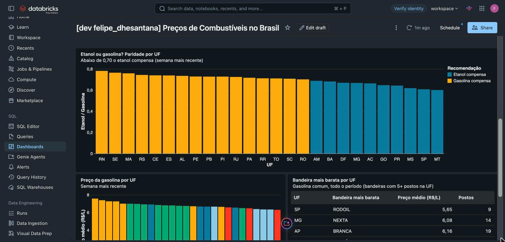
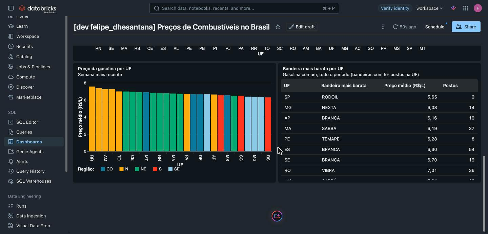
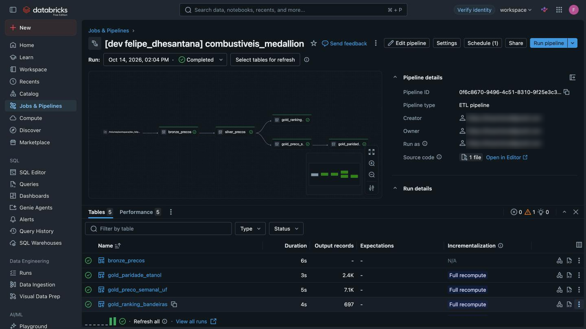
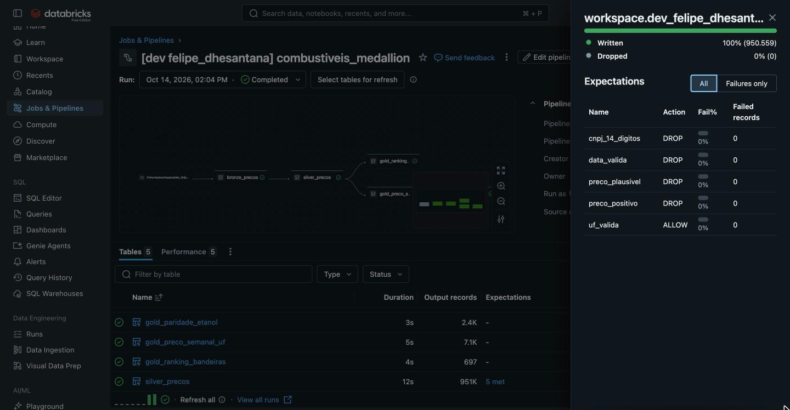
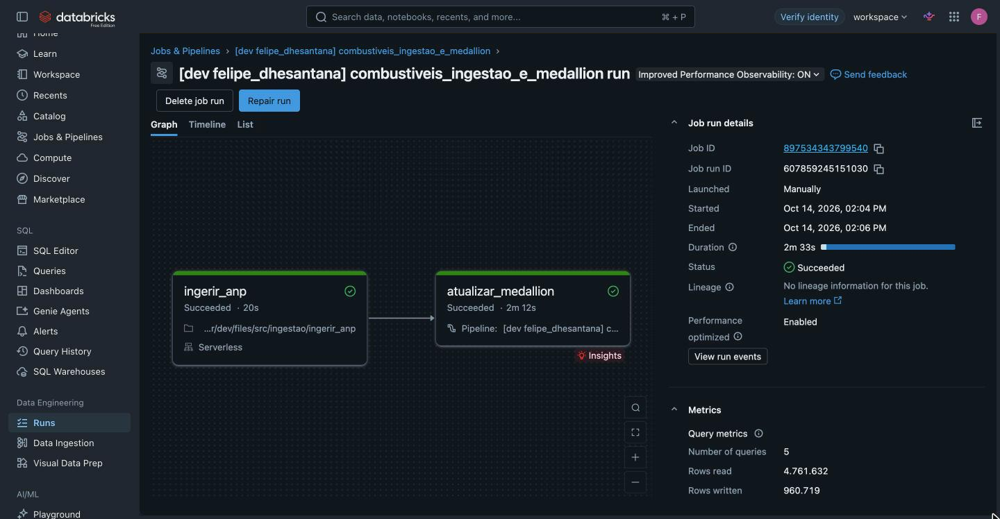
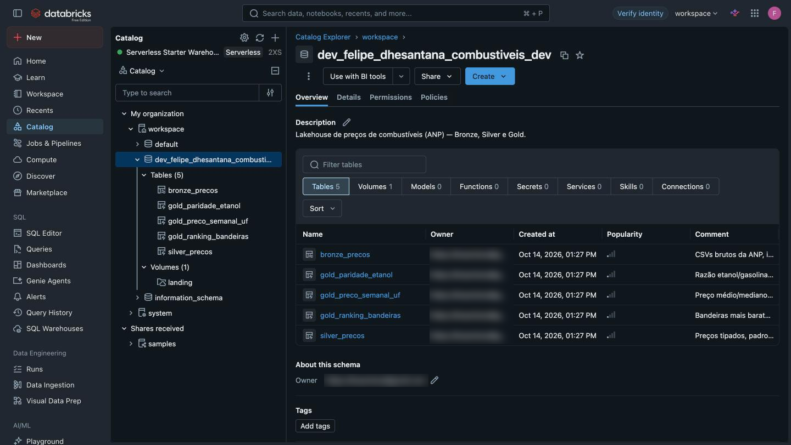
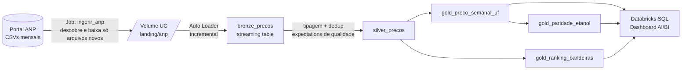

# ⛽ Lakehouse de Preços de Combustíveis no Brasil

[](https://github.com/santana7o/lakehouse-combustiveis-br/actions/workflows/ci.yml)


Pipeline de dados ponta a ponta no **Databricks** que coleta automaticamente os preços de gasolina e
etanol publicados pela **ANP**, organiza tudo em uma arquitetura **Medallion (Bronze → Silver → Gold)**
com **Delta Lake** e **Unity Catalog**, valida a qualidade dos dados com **expectations** e entrega um
**dashboard AI/BI** que responde: *em quais estados o etanol compensa mais que a gasolina?* Toda a
infraestrutura (schema, volume, pipeline, job agendado e dashboard) é código, versionada com
**Databricks Asset Bundles** e testada no **GitHub Actions**.

**Perguntas de negócio respondidas**

- Em quais estados o **etanol compensa** mais que a gasolina? (regra dos 70%)
- Como o preço evoluiu semana a semana em cada região?
- Qual **bandeira** de posto é mais barata em cada estado?

## Prints do projeto rodando no Databricks

Capturas reais do workspace (Databricks Free Edition), em 14/10/2026.

### Dashboard AI/BI
Publicado como recurso do bundle e alimentado pelas tabelas Gold.





### Pipeline declarativo Bronze → Silver → Gold
Todas as tabelas atualizadas com sucesso; a Silver tem 951 mil registros.



### Qualidade de dados
As 5 expectations da Silver: 4 descartam linhas (DROP) e 1 só registra (ALLOW). Nenhuma falha nesta execução.



### Orquestração
Job serverless com duas tasks: ingestão da ANP e, em seguida, a atualização do pipeline.



### Unity Catalog
Schema com as 5 tabelas e o Volume de landing, todos criados pelo bundle.



## Arquitetura



| Camada | Tabela | O que tem |
|---|---|---|
| Bronze | `bronze_precos` | CSV bruto (tudo string) + arquivo de origem e horário de ingestão |
| Silver | `silver_precos` | Tipado (decimal, data), CNPJ/CEP normalizados, deduplicado, com *liquid clustering* por UF/produto |
| Gold | `gold_preco_semanal_uf` | Média, mediana, mín, máx e nº de postos por semana × UF × produto |
| Gold | `gold_paridade_etanol` | Razão etanol/gasolina e flag `etanol_compensa` |
| Gold | `gold_ranking_bandeiras` | Ranking de bandeiras por preço em cada UF |

Detalhes de cada camada, schemas das tabelas, regras de qualidade e ambientes em
[`docs/arquitetura.md`](docs/arquitetura.md).

## Resultados (execução real em 14/10/2026)

Executado na **Databricks Free Edition (serverless)**:

| Métrica | Valor |
|---|---|
| Arquivos mensais da ANP | **20** (jan/2025 a set/2026; abr/2026 não foi publicado pela ANP) |
| Linhas no Bronze | **950.563** |
| Linhas no Silver | **950.559** (4 coletas duplicadas removidas; 0 falhas nas expectations) |
| UFs cobertas | **27** |

**Onde o etanol compensa** (semana mais recente, paridade ≤ 0,70):

| UF | Etanol (R$/L) | Gasolina (R$/L) | Paridade |
|---|---|---|---|
| MT | 4,145 | 6,909 | 0,60 |
| SP | 3,876 | 6,383 | 0,61 |
| MS | 4,046 | 6,548 | 0,62 |
| PR | 4,223 | 6,574 | 0,64 |
| GO | 4,309 | 6,671 | 0,65 |

**Gasolina mais cara:** RR (R$ 7,57), RO (R$ 7,39) e AM (R$ 7,26). A Região Norte lidera.

## Destaques técnicos

- **Lakeflow Declarative Pipelines (DLT)** com **expectations** de qualidade: linhas sem data, com
  preço ≤ 0 ou implausível (≥ R$ 20) ou com CNPJ inválido são descartadas e **contabilizadas** no
  event log (consulta pronta em [`sql/analises.sql`](sql/analises.sql)).
- **Ingestão incremental e idempotente**: o job lê a página da ANP, descobre os links (a ANP muda o
  padrão de nome de arquivo, inclusive com erro de digitação, como `02-cados-abertos-...`) e baixa só
  o que ainda não existe, com escrita atômica. O **Auto Loader** garante *exactly-once* no Bronze.
- **Lógica de negócio separada do runtime**: as transformações ficam em
  [`src/combustiveis/transformacoes.py`](src/combustiveis/transformacoes.py) como funções puras de
  PySpark, testadas com **pytest** localmente e no CI.
- **Infraestrutura como código**: [`databricks.yml`](databricks.yml) + [`resources/`](resources)
  declaram schema, volume, pipeline, job e **dashboard AI/BI**, com targets `dev` (isolado, agenda
  pausada) e `prod` (agenda ativa).
- **Orquestração**: job com duas tasks (`ingerir_anp` → `atualizar_medallion`), toda segunda às 8h
  (America/Sao_Paulo), com retentativas na ingestão e e-mail em caso de falha.
- **Serverless**: roda inteiro na **Databricks Free Edition**, sem configurar cluster.

## Decisões de engenharia

| Decisão | Por quê |
|---|---|
| **Medallion (Bronze/Silver/Gold)** | Bronze guarda o dado como veio (reprocessável e auditável); Silver concentra tipagem, limpeza e dedup uma única vez; Gold entrega agregados prontos para o consumo, então o dashboard não recalcula nada pesado. |
| **Auto Loader no Bronze** | Controla via checkpoint quais arquivos já foram lidos: só processa CSVs novos, sem lógica de controle manual, e lida com mudança de schema (`rescue`) sem quebrar o pipeline. |
| **Expectations: `drop` vs `warn`** | Regras que tornam a linha inútil para análise (sem data, preço fora da faixa, CNPJ inválido) usam `expect_or_drop` para não contaminar médias. A regra de UF usa `expect` (só alerta): o problema é registrado nas métricas sem perder a linha. Nenhuma regra usa `fail`, para que um único registro ruim da ANP não pare a carga semanal. |
| **Funções puras + testes** | As transformações recebem e devolvem DataFrames, sem depender de `dlt`, `dbutils` ou do workspace. Assim rodam em PySpark local, no pytest e no CI, e o arquivo do pipeline fica só com a "fiação". |
| **Databricks Asset Bundles** | Um único `databricks bundle deploy` cria tudo de forma reproduzível; o mesmo código vai para `dev` (isolado por usuário) e `prod`, e muda via pull request como qualquer código. |

## Estrutura

```
├── databricks.yml                  # Bundle: variáveis e targets dev/prod
├── resources/
│   ├── catalogo.yml                # Schema + Volume no Unity Catalog
│   ├── pipeline.yml                # Pipeline declarativo serverless
│   ├── job.yml                     # Job semanal: ingestão → pipeline
│   └── dashboard.yml               # Dashboard AI/BI
├── src/
│   ├── combustiveis/               # Código Python reutilizável e testável
│   │   ├── descoberta.py           # Descoberta e download dos CSVs da ANP
│   │   └── transformacoes.py       # Transformações puras Silver/Gold
│   ├── ingestao/ingerir_anp.py     # Notebook da ingestão
│   ├── pipeline/medallion.py       # Definição Bronze/Silver/Gold + expectations
│   └── dashboard/combustiveis.lvdash.json  # Definição do dashboard
├── sql/analises.sql                # Consultas de negócio e de qualidade
├── tests/                          # pytest + PySpark local
├── docs/
│   ├── arquitetura.md              # Documentação técnica detalhada
│   └── img/                        # Prints do projeto no Databricks
└── .github/workflows/ci.yml        # Lint, testes e validação do bundle
```

## Como rodar

### 1. Pré-requisitos
- Conta na [Databricks Free Edition](https://www.databricks.com/learn/free-edition)
- [Databricks CLI](https://docs.databricks.com/dev-tools/cli/install.html) ≥ 0.250

```bash
brew tap databricks/tap && brew install databricks
```

### 2. Autenticar (abre o navegador para login)
```bash
databricks auth login --host https://<seu-workspace>.cloud.databricks.com
```

> O `host` em [`databricks.yml`](databricks.yml) aponta para o workspace do autor; troque pelo seu.

### 3. Deploy e execução

```bash
databricks bundle validate

# Desenvolvimento: recursos prefixados com seu usuário, agenda pausada
databricks bundle deploy -t dev
databricks bundle run combustiveis_job -t dev

# Produção: schema `combustiveis`, job semanal ativo (segunda, 8h)
databricks bundle deploy -t prod
databricks bundle run combustiveis_job -t prod
```

O deploy publica o dashboard **"Preços de Combustíveis no Brasil"** (em **Dashboards** no workspace),
usando o SQL warehouse `Serverless Starter Warehouse`. As consultas avulsas estão em
[`sql/analises.sql`](sql/analises.sql) (ajuste o `USE SCHEMA` para o seu schema).

> **Se a ingestão falhar por bloqueio de internet** (a Free Edition limita o acesso de saída do
> serverless), baixe os CSVs em <https://www.gov.br/anp/pt-br/centrais-de-conteudo/dados-abertos/serie-historica-de-precos-de-combustiveis>
> e envie para o Volume `landing` do schema criado pelo bundle (em dev:
> `workspace.dev_<seu_usuario>_combustiveis_dev.landing`), pasta `anp/` (Catalog → Volume →
> *Upload to this volume*). Depois rode só o pipeline: `databricks bundle run combustiveis_pipeline -t dev`.

### Testes locais
Requer Java 17 e [uv](https://docs.astral.sh/uv/).
```bash
uv sync --group dev
uv run ruff check .
uv run pytest -v
```

O CI ([`.github/workflows/ci.yml`](.github/workflows/ci.yml)) roda lint + testes em todo push/PR e,
se `DATABRICKS_HOST` e `DATABRICKS_TOKEN` estiverem configurados no repositório, também
`databricks bundle validate -t dev`.

## Próximos passos

> Ideias para evoluir o projeto. **Nenhuma delas está implementada.**

- Incluir as outras séries da ANP (diesel, GNV, GLP) no mesmo pipeline.
- Camada Gold por município, para comparar preços dentro de um mesmo estado.
- Alerta automático quando a paridade de uma UF cruzar o limite de 0,70.
- Deploy contínuo: `bundle deploy -t prod` no GitHub Actions após merge na `main`.
- Testes de integração do pipeline completo com uma amostra de CSV real.

## Fonte dos dados
[ANP — Série Histórica de Preços de Combustíveis](https://www.gov.br/anp/pt-br/centrais-de-conteudo/dados-abertos/serie-historica-de-precos-de-combustiveis),
publicada sob licença de dados abertos do Governo Federal.
