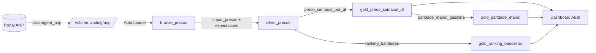

# Arquitetura

Documento técnico do lakehouse de preços de combustíveis. Visão geral e instruções de uso no
[README](../README.md).

## Visão geral

Todos os objetos ficam no catálogo `workspace` (variável `catalogo`) e em um único schema
(variável `schema`), criado pelo próprio bundle em [`resources/catalogo.yml`](../resources/catalogo.yml).

| Recurso do bundle | Arquivo | O que é |
|---|---|---|
| `schemas.combustiveis` | `resources/catalogo.yml` | Schema do Unity Catalog com todas as tabelas |
| `volumes.landing` | `resources/catalogo.yml` | Volume gerenciado onde os CSVs brutos são gravados |
| `pipelines.combustiveis_pipeline` | `resources/pipeline.yml` | Pipeline declarativo serverless (`combustiveis_medallion`) |
| `jobs.combustiveis_job` | `resources/job.yml` | Job `combustiveis_ingestao_e_medallion` |
| `dashboards.combustiveis_dashboard` | `resources/dashboard.yml` | Dashboard AI/BI "Preços de Combustíveis no Brasil" |

## Ingestão (landing)

Código: [`src/combustiveis/descoberta.py`](../src/combustiveis/descoberta.py), executado pelo notebook
[`src/ingestao/ingerir_anp.py`](../src/ingestao/ingerir_anp.py).

1. Baixa o HTML da página oficial da série histórica da ANP.
2. Extrai por regex os links `.../shpc/dsan/<ano>/...gasolina-etanol....csv` com `ano >= ano_inicial`
   (padrão `2025`). Ler a página, em vez de montar URLs, protege contra a falta de padrão nos nomes
   da ANP (`precos-gasolina-etanol-01.csv`, `01-dados-abertos-...`, `02-cados-abertos-...`). Links
   duplicados, de outros produtos (diesel/GNV) e o arquivo de "últimas 4 semanas" são ignorados.
3. Grava cada arquivo como `<ano>_<nome-original>.csv` em `/Volumes/<catalogo>/<schema>/landing/anp`,
   **pulando os que já existem** (idempotente).
4. A escrita é atômica: grava `*.tmp` e renomeia. O Bronze lê só `*.csv`, então nunca pega um arquivo
   pela metade.

Parâmetros do notebook (widgets): `catalogo`, `schema`, `ano_inicial`.

## Bronze — `bronze_precos`

*Streaming table* alimentada pelo **Auto Loader** (`cloudFiles`) sobre o volume de landing.

- Formato CSV, separador `;`, cabeçalho, UTF-8, filtro `*.csv`.
- `inferColumnTypes = false`: **tudo string**, o dado fica como veio da fonte.
- `schemaEvolutionMode = rescue`: colunas inesperadas vão para `_rescued_data` em vez de quebrar a carga.
- Os cabeçalhos da ANP são renomeados para snake_case por `normalizar_colunas` (tratando o BOM do CSV).

| Coluna | Tipo | Origem no CSV da ANP |
|---|---|---|
| `regiao` | string | Regiao - Sigla |
| `uf` | string | Estado - Sigla |
| `municipio` | string | Municipio |
| `revenda` | string | Revenda |
| `cnpj_revenda` | string | CNPJ da Revenda |
| `logradouro` | string | Nome da Rua |
| `numero` | string | Numero Rua |
| `complemento` | string | Complemento |
| `bairro` | string | Bairro |
| `cep` | string | Cep |
| `produto` | string | Produto |
| `data_coleta` | string | Data da Coleta |
| `valor_venda` | string | Valor de Venda |
| `valor_compra` | string | Valor de Compra |
| `unidade_medida` | string | Unidade de Medida |
| `bandeira` | string | Bandeira |
| `_rescued_data` | string | Gerada pelo Auto Loader (modo `rescue`) |
| `_arquivo_origem` | string | `_metadata.file_name` |
| `_ingerido_em` | timestamp | `current_timestamp()` na ingestão |

## Silver — `silver_precos`

Função [`limpar_precos`](../src/combustiveis/transformacoes.py) + expectations, com *liquid clustering*
por `uf` e `produto` (os filtros mais comuns das consultas).

Transformações:

- Textos com `trim`; `regiao`, `uf`, `municipio`, `produto` e `bandeira` em maiúsculas.
- `cnpj_revenda` e `cep`: só dígitos.
- `data_coleta`: `dd/MM/yyyy` → `date`.
- `valor_venda` / `valor_compra`: formato brasileiro (`5,99`) → `decimal(10,3)`; vazio vira nulo.
- `semana`: segunda-feira da semana da coleta (`date_trunc('week')`).
- Deduplicação por (`cnpj_revenda`, `produto`, `data_coleta`): um preço por posto, produto e dia.

| Coluna | Tipo |
|---|---|
| `regiao` | string |
| `uf` | string |
| `municipio` | string |
| `revenda` | string |
| `cnpj_revenda` | string (14 dígitos) |
| `cep` | string (só dígitos) |
| `produto` | string |
| `data_coleta` | date |
| `valor_venda` | decimal(10,3) |
| `valor_compra` | decimal(10,3) |
| `unidade_medida` | string |
| `bandeira` | string |
| `semana` | date |

Colunas de endereço (`logradouro`, `numero`, `complemento`, `bairro`) ficam só no Bronze.

## Qualidade de dados

Expectations declaradas em [`src/pipeline/medallion.py`](../src/pipeline/medallion.py), aplicadas na
Silver:

| Nome | Regra | Ação |
|---|---|---|
| `data_valida` | `data_coleta IS NOT NULL` | descarta a linha |
| `preco_positivo` | `valor_venda > 0` | descarta a linha |
| `preco_plausivel` | `valor_venda < 20` | descarta a linha |
| `cnpj_14_digitos` | `length(cnpj_revenda) = 14` | descarta a linha |
| `uf_valida` | `length(uf) = 2` | só registra (mantém a linha) |

- **Drop** nas regras que tornam o registro inútil para média de preço; **warn** na UF, que é
  informativa. Nenhuma regra usa `fail`: um registro ruim da ANP não interrompe a carga semanal.
- As contagens de aprovadas/reprovadas por regra vão para o **event log** do pipeline. A consulta 5 de
  [`sql/analises.sql`](../sql/analises.sql) lê `event_log(TABLE(silver_precos))`.
- Na execução de 14/10/2026: 950.563 linhas no Bronze → 950.559 na Silver (4 coletas duplicadas removidas pela deduplicação; nenhuma linha reprovada nas expectations).

Testes unitários em [`tests/`](../tests) cobrem: renomeação de colunas com BOM, conversão de decimal
e data brasileiros, normalização de CNPJ/CEP, cálculo da semana, deduplicação, paridade e ranking, e
o filtro de links da ANP.

## Gold

Tabelas recalculadas a partir da Silver a cada atualização do pipeline.

### `gold_preco_semanal_uf`

Função `preco_semanal_por_uf`. Grão: semana × região × UF × produto.

| Coluna | Tipo | Cálculo |
|---|---|---|
| `semana` | date | chave |
| `regiao` | string | chave |
| `uf` | string | chave |
| `produto` | string | chave |
| `preco_medio` | decimal | `round(avg(valor_venda), 3)` |
| `preco_mediano` | decimal | `round(percentile_approx(valor_venda, 0.5), 3)` |
| `preco_minimo` | decimal(10,3) | `min(valor_venda)` |
| `preco_maximo` | decimal(10,3) | `max(valor_venda)` |
| `postos_pesquisados` | bigint | `count(distinct cnpj_revenda)` |

### `gold_paridade_etanol`

Função `paridade_etanol_gasolina`, lida a partir de `gold_preco_semanal_uf`. Grão: semana × região × UF,
só onde há preço de etanol **e** de gasolina.

| Coluna | Tipo | Cálculo |
|---|---|---|
| `semana` | date | chave |
| `regiao` | string | chave |
| `uf` | string | chave |
| `preco_etanol` | decimal | `preco_medio` do ETANOL |
| `preco_gasolina` | decimal | `preco_medio` da GASOLINA |
| `paridade` | double | `round(preco_etanol / preco_gasolina, 3)` |
| `etanol_compensa` | boolean | `paridade <= 0.70` |

O limite de 0,70 (`LIMITE_PARIDADE_ETANOL`) é a regra de bolso do rendimento energético médio de
motores flex.

### `gold_ranking_bandeiras`

Função `ranking_bandeiras`. Grão: UF × produto × bandeira, considerando todo o histórico da Silver.

| Coluna | Tipo | Cálculo |
|---|---|---|
| `uf` | string | chave |
| `produto` | string | chave |
| `bandeira` | string | chave |
| `preco_medio` | decimal | `round(avg(valor_venda), 3)` |
| `postos` | bigint | `count(distinct cnpj_revenda)` |
| `ranking` | int | `dense_rank()` por (`uf`, `produto`) ordenado por `preco_medio` (1 = mais barata) |

## Consumo: dashboard AI/BI

[`src/dashboard/combustiveis.lvdash.json`](../src/dashboard/combustiveis.lvdash.json), publicado pelo
bundle no warehouse `Serverless Starter Warehouse`. As consultas usam nomes curtos de tabela; catálogo
e schema vêm do target (`dataset_catalog` / `dataset_schema`), então o mesmo arquivo serve a dev e prod.

Página "Visão geral":

- Contadores: coletas de preço, postos pesquisados, municípios e data da última coleta (Silver).
- Linha: evolução do preço da gasolina por região.
- Barras: paridade etanol/gasolina por UF na última semana.
- Barras: preço da gasolina por UF na última semana.
- Tabela: bandeira mais barata por UF.

## Orquestração

Job `combustiveis_ingestao_e_medallion` ([`resources/job.yml`](../resources/job.yml)):

| Task | Tipo | Depende de | Detalhes |
|---|---|---|---|
| `ingerir_anp` | notebook | — | Até 2 retentativas, intervalo mínimo de 60 s |
| `atualizar_medallion` | pipeline | `ingerir_anp` | Atualiza Bronze → Silver → Gold |

- Agenda: `0 0 8 ? * MON`, toda segunda às 8h, fuso `America/Sao_Paulo`.
- E-mail para o usuário que fez o deploy em caso de falha.
- Pipeline e notebook rodam em **serverless**.

## Ambientes

Definidos em [`databricks.yml`](../databricks.yml):

| | `dev` (padrão) | `prod` |
|---|---|---|
| Modo do bundle | `development` | `production` |
| Schema | `combustiveis_dev`, prefixado com o usuário (ex.: `dev_<usuario>_combustiveis_dev`) | `combustiveis` |
| Nomes dos recursos | prefixo `[dev <usuario>]` | nomes definidos nos YAML |
| Agenda do job | pausada | ativa (segunda, 8h) |
| Pasta no workspace | padrão do bundle | `/Workspace/Users/<usuario>/.bundle/lakehouse_combustiveis_br/prod` |
| Permissões | padrão | `CAN_MANAGE` para o usuário do deploy |

Variáveis do bundle: `catalogo` (padrão `workspace`), `schema`, `warehouse_id` (lookup do
`Serverless Starter Warehouse`) e `ano_inicial` (padrão `2025`).

## CI

[`.github/workflows/ci.yml`](../.github/workflows/ci.yml), em push na `main` e em pull requests:

- **testes**: Java 17 + Python 3.12 via uv, `ruff check` e `pytest` com PySpark local.
- **validar-bundle**: `databricks bundle validate -t dev`, só quando a variável `DATABRICKS_HOST` e o
  segredo `DATABRICKS_TOKEN` estão configurados no repositório.
